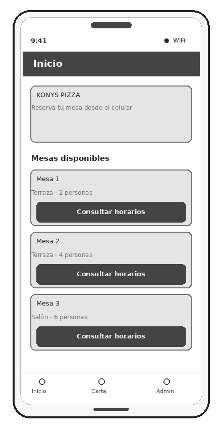
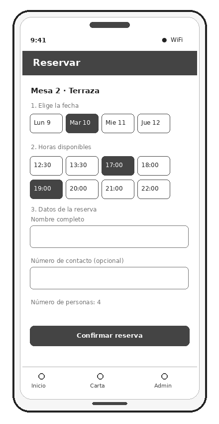
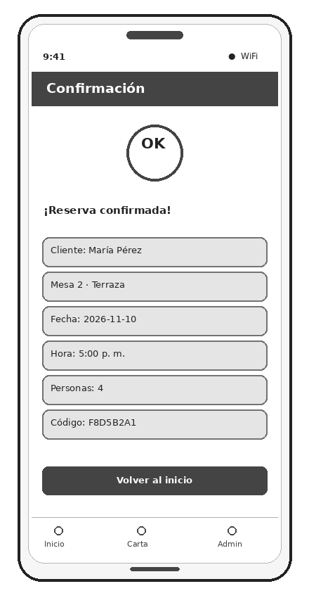
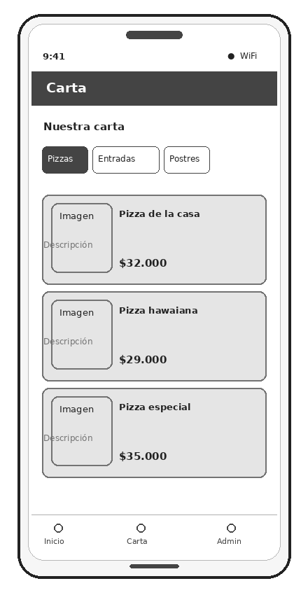
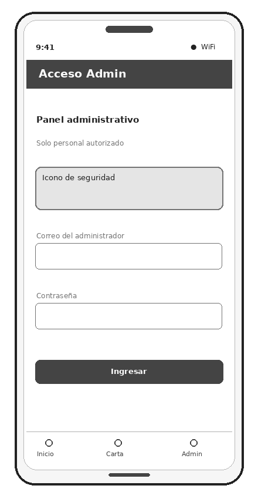
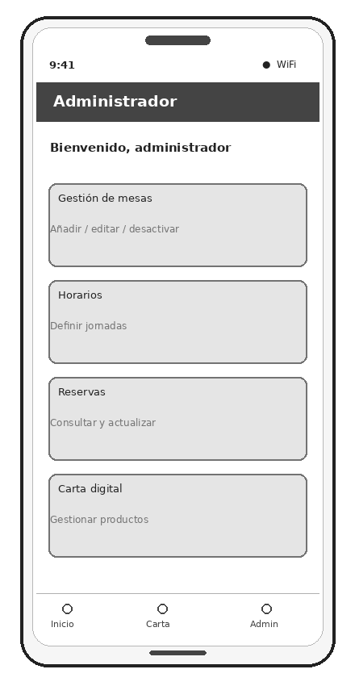
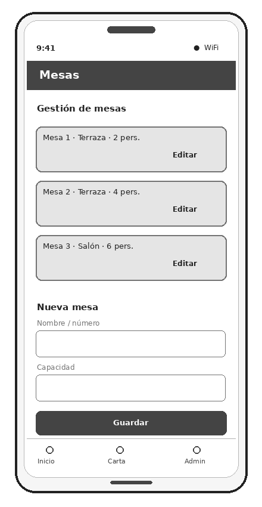
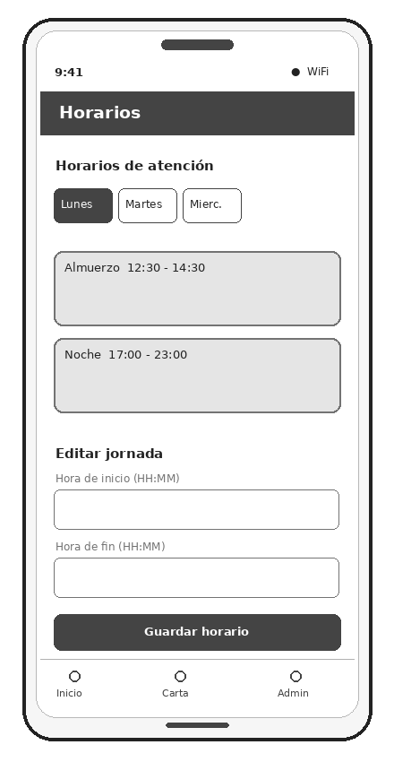
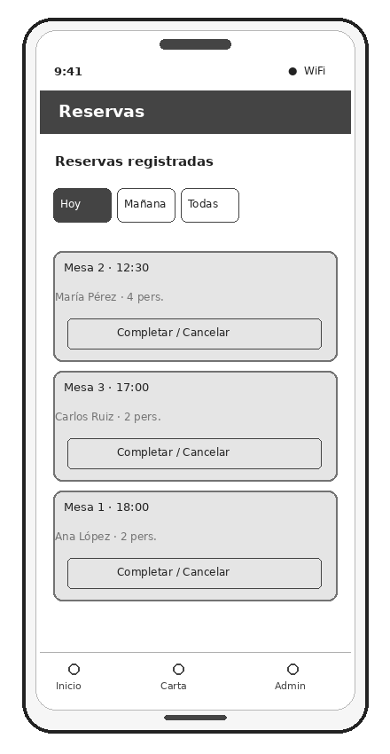

# Diseño de la interfaz de KONYS PIZZA

**Entrega:** 16 de noviembre de 2026.
**Institución:** Corporación Universitaria de Ciencia y Desarrollo – UNICIENCIA.
**Programa y asignatura:** Ingeniería de Sistemas · Programación Móvil.
**Integrantes:** Yefry Fernando Amaya Barbosa y Andrés David Pérez Pardo.
**Docente:** Carlos Carrascal.

## Alcance y evidencia

Este documento describe el diseño implementado en el código del proyecto. No es una certificación de correspondencia con los mockups ni de compatibilidad visual en todos los dispositivos. El [README](../README.md) informa pruebas previas en iPhone mediante Expo Go; la revisión documental del 16 de noviembre no incluyó una nueva inspección visual en un teléfono o navegador. Las comprobaciones automatizadas y sus límites se describen en [PRUEBAS.md](PRUEBAS.md).

Referencia de diseño proporcionada por el equipo: [archivo de Figma de KONYS PIZZA](https://www.figma.com/design/806IGdyG1UszxCUV8fIIyZ). Su contenido y permisos de acceso no se comprobaron durante esta documentación. También se incorporó el [PDF original con nueve mockups](mockups/KONYS_PIZZA_9_Mockups.pdf), aportado por el equipo, junto con sus nueve imágenes extraídas sin modificar el diseño. Los enlaces directos a los frames de Figma y las capturas reales de la aplicación siguen pendientes; los bocetos del PDF no sustituyen esas capturas.

## Identidad visual implementada

La fuente principal de los valores de diseño es [src/constants/konys.ts](../src/constants/konys.ts).

| Elemento | Valor o tratamiento en el código | Uso |
| --- | --- | --- |
| Azul petróleo | `#073847`; tono profundo `#052E3A` | Identidad, textos destacados, cabeceras y bloques de presentación. |
| Naranja | `#F47A20` | Acciones principales y acentos de marca. |
| Fondo claro y tarjetas | `#F6F8F8` y `#FFFFFF` | Separación entre el fondo general y las superficies de contenido. |
| Texto y texto secundario | `#17323B` y `#5A7078` | Jerarquía de lectura y descripciones. |
| Bordes | `#DEE7E9` | Separación de tarjetas y campos. |
| Éxito y error | `#21684D` y `#AB3439`, con fondos suaves | Avisos y estados acompañados de texto; no dependen únicamente del color. |
| Tipografía compartida | Título 30/37, subtítulo 21/28, cuerpo 15/24, etiqueta 14/21 y texto breve 12/19 | Tamaño/interlineado definidos en estilos de React Native; algunas pantallas ajustan los títulos. |
| Espaciado | 4, 8, 12, 16, 24 y 32 | Separación consistente entre elementos. |
| Esquinas | Radios 10, 16, 24, 32 y forma de píldora | Tarjetas, botones, campos y filtros. |

Los elementos reutilizables están en [src/components/konys/ui.tsx](../src/components/konys/ui.tsx): `Screen`, `AppText`, `Card`, `Row`, `Section`, `Button`, `Chip`, `Field`, `Badge`, `Notice` y `EmptyState`. Su reutilización mantiene la misma presentación de cargas, errores, campos y acciones en cliente y administración.

## Navegación y estructura común

[src/app/_layout.tsx](../src/app/_layout.tsx) contiene el contenedor común, la marca, el área de navegación y la barra inferior con **Inicio**, **Carta** y **Admin**. Las pantallas se organizan con Expo Router y un `Stack`; la barra inferior es una implementación de botones de navegación, no tres aplicaciones separadas.

El recorrido de reserva conecta Inicio, selección de mesa/fecha/horario, formulario y confirmación. La carta puede abrirse desde la barra inferior, Inicio o la confirmación. Los botones «Volver» usan el historial cuando existe y una ruta alternativa cuando no existe.

[src/app/admin/_layout.tsx](../src/app/admin/_layout.tsx) controla el acceso visual a las rutas administrativas: muestra verificación de sesión y redirige al acceso cuando falta permiso. Los dos archivos `_layout.tsx` son contenedores de navegación; **no se cuentan como pantallas independientes** del inventario.

## Inventario de pantallas del cliente

| Pantalla y ruta | Archivo y componente | Elementos principales | Estados y observaciones |
| --- | --- | --- | --- |
| Inicio `/` | [index.tsx](../src/app/index.tsx), `HomeScreen` | Presentación de marca, ilustración, botón de reserva, jornadas de hoy, filtro por zona, tarjetas de mesa con nombre/zona/capacidad/estado y acceso a carta. | Carga, error con reintento, ausencia de mesas o de jornadas. Una mesa habilitada no garantiza un horario libre: la disponibilidad se consulta para la fecha elegida. |
| Selección `/reservar` | [reservar.tsx](../src/app/reservar.tsx), `ReserveScreen` | Pasos de reserva, selección de mesa, fecha, jornada y franja, resumen y botón para continuar. | Selección inválida, mesa no disponible, consulta de ocupación, error, ausencia de franjas y horario seleccionado. Una actualización con datos disponibles no sustituye todo el contenido por la carga inicial. |
| Datos del cliente `/reserva-formulario` | [reserva-formulario.tsx](../src/app/reserva-formulario.tsx), `ReservationFormScreen` | Resumen de mesa/fecha/hora, nombre, cantidad de personas, contacto opcional y confirmación. | Errores de nombre/capacidad, verificación de disponibilidad, envío pendiente y reserva enviada. Se deshabilitan acciones durante el envío y se informa si el horario ya no está disponible. |
| Confirmación `/confirmacion` | [confirmacion.tsx](../src/app/confirmacion.tsx), `ConfirmationScreen` | Referencia, estado y detalles de la reserva; regreso al inicio y acceso a carta. | Si no están disponibles los detalles en memoria, presenta la referencia y explica que recargar o abrir el enlace en otro dispositivo no recupera el comprobante completo ni cancela la reserva. |
| Carta `/carta` | [carta.tsx](../src/app/carta.tsx), `MenuScreen` | Filtros Todo/Pizzas/Entradas/Postres/Bebidas, secciones, ilustraciones, nombre, descripción y precio en COP. | Carga, error, carta vacía o categoría sin productos visibles. Incluye aviso de precios de referencia de Rappi que pueden variar en el punto de venta. |

El resumen y los pasos compartidos del flujo están en [src/components/client/booking.tsx](../src/components/client/booking.tsx). La consulta de disponibilidad y sus estados proceden de [src/hooks/use-availability.ts](../src/hooks/use-availability.ts).

## Inventario de pantallas administrativas

| Pantalla o vista y ruta | Archivo y componente | Elementos principales | Estados y observaciones |
| --- | --- | --- | --- |
| Acceso `/admin`, sin autorización | [admin/index.tsx](../src/app/admin/index.tsx), `AdminScreen` | Bloque de marca, correo, contraseña oculta y botón de ingreso. | Campos incompletos, ingreso pendiente y mensajes de error. Una sesión sin permiso muestra una vista de acceso denegado y permite cerrar sesión para usar otra cuenta. No hay PIN de demostración. |
| Panel `/admin`, con autorización | [admin/index.tsx](../src/app/admin/index.tsx), `AdminScreen` | Tarjetas Mesas, Horarios, Reservas y Carta; conteos y cierre de sesión. | Comparte la ruta con acceso: el contenido depende de la sesión y los permisos. El conteo de reservas corresponde a las confirmadas de hoy. |
| Mesas `/admin/mesas` | [admin/mesas.tsx](../src/app/admin/mesas.tsx), `AdminTablesScreen` | Listado de mesas, capacidad y zona, cambio Disponible/Inactiva y acceso a Nueva mesa. | Acción pendiente, éxito y error. Cambiar el estado no cancela reservas existentes. No representa un plano físico interactivo del restaurante. |
| Nueva mesa `/admin/nueva-mesa` | [admin/nueva-mesa.tsx](../src/app/admin/nueva-mesa.tsx), `NewTableScreen` | Nombre, zona, opciones rápidas de zona, capacidad, estado inicial y acciones Guardar/Cancelar. | Validación y guardado pendiente; los campos se deshabilitan durante la operación. |
| Horarios `/admin/horarios` | [admin/horarios.tsx](../src/app/admin/horarios.tsx), `AdminShiftsScreen`; [shift-editor.tsx](../src/components/admin/shift-editor.tsx), `ShiftEditor` | Jornadas por día; nombre, apertura/cierre, duración, estado activa/pausada y alta de jornada. | Lista vacía, edición, alta, validación, guardado y error. Las horas se presentan como horarios de Colombia. |
| Reservas `/admin/reservas` | [admin/reservas.tsx](../src/app/admin/reservas.tsx), `AdminReservationsScreen` | Filtros por fecha, mesa y estado, datos de reserva, completar y cancelar. | Sin resultados, fecha inválida, actualización pendiente, éxito/error y confirmación explícita antes de cancelar. |
| Carta administrativa `/admin/carta` | [admin/carta.tsx](../src/app/admin/carta.tsx), `AdminMenuScreen` | Lista por categoría, productos visibles/ocultos, agregar, editar y cambiar visibilidad. | Categoría vacía, cambio pendiente, éxito y error. Ocultar conserva el registro; no es eliminación del plato. |
| Alta y edición `/admin/plato` | [admin/plato.tsx](../src/app/admin/plato.tsx), `DishScreen` y `DishForm` | Nombre, descripción, categoría, precio COP, visibilidad, guardar y cancelar. | Sin parámetro `id` crea; con `id` edita. Incluye carga inicial, registro no encontrado y validación. Con el plato ya cargado, una actualización conserva el tipo y clave del formulario. |

Las vistas de acceso y panel comparten archivo y ruta. Las variantes nuevo/editar plato también comparten pantalla; se documentan como variantes de uso, no como archivos adicionales.

## Adaptación, accesibilidad y recursos gráficos

- El contenido de `Screen` tiene ancho máximo de 1200 y márgenes adaptables. La carta usa tarjetas de una, dos o tres columnas según el ancho; Inicio también adapta su cabecera y tarjetas. Los formularios limitan su ancho para mantener legibilidad.
- [use-layout-width.ts](../src/hooks/use-layout-width.ts), `useLayoutWidth`, ofrece el mismo valor inicial de ancho al servidor y al cliente durante la hidratación. La prueba automatizada de HTML inicial no sustituye la comprobación en un navegador real.
- El contenedor común utiliza áreas seguras y `KeyboardAvoidingView`; los formularios especifican teclados adecuados para correo, teléfono o números. Sigue pendiente revisar foco, teclado y conservación visual del formulario al renovar sesión en dispositivos reales.
- Botones, filtros y campos incluyen etiquetas y estados de accesibilidad. Los campos muestran errores textuales; existen estilos de foco y áreas mínimas de interacción en los componentes compartidos. No se declara certificación WCAG ni prueba de lector de pantalla o contraste realizada.
- [icon.tsx](../src/components/konys/icon.tsx) y [product-art.tsx](../src/components/konys/product-art.tsx) implementan recursos locales. `ProductArt` presenta ilustraciones SVG, con etiqueta «ILUSTRACIÓN» en las tarjetas; no son fotografías reales de los platos.
- [product-media.ts](../src/constants/product-media.ts) contiene un mapa vacío para futuras fotografías autorizadas. La referencia a Rappi corresponde al aviso de precios de la carta; no acredita precios actuales ni uso de fotografías de esa plataforma.

## Nueve mockups originales del PDF

Se verificaron **nueve páginas y nueve diseños**, con una imagen por página, en [KONYS_PIZZA_9_Mockups.pdf](mockups/KONYS_PIZZA_9_Mockups.pdf). El documento los identifica como **mockups de baja fidelidad**, no capturas de la aplicación final.

Los PNG conservan los píxeles RGB y la resolución nativa de **440 × 850 píxeles** de las imágenes incrustadas. Se extrajeron directamente, sin reescalar, redibujar, recolorear ni recortar los bocetos. Se conserva una copia idéntica del PDF como evidencia de procedencia, con sus encabezados y pies de página. Se abrieron visualmente las nueve imágenes y se comprobó que son distintas y que sus píxeles coinciden con los del PDF.

### 1. Inicio

**Página 1 · Archivo:** `mockups/01-inicio.png`.

Presentación de KONYS PIZZA, tarjetas de mesas con zona y capacidad, botones para consultar horarios y navegación inferior Inicio, Carta y Admin.

### 2. Reserva

**Página 2 · Archivo:** `mockups/02-reserva.png`.

Selección de fecha y hora para una mesa, campos de nombre y contacto opcional, cantidad de personas y botón para confirmar. El boceto reúne selección y datos del cliente en una sola pantalla.

### 3. Confirmación de reserva

**Página 3 · Archivo:** `mockups/03-confirmacion-reserva.png`.

Mensaje de reserva confirmada y resumen del cliente, mesa, fecha, hora, personas y código de referencia, con regreso al inicio. Los valores mostrados pertenecen al boceto aportado, no a una consulta de Supabase.

### 4. Carta digital

**Página 4 · Archivo:** `mockups/04-carta-digital.png`.

Categorías Pizzas, Entradas y Postres, tarjetas con espacios para imágenes, descripción y precio, y navegación inferior. Los productos y precios se conservaron tal como aparecen en el PDF; no representan una validación de la carta actual.

### 5. Acceso del administrador

**Página 5 · Archivo:** `mockups/05-acceso-administrador.png`.

Vista de acceso para personal autorizado, con espacio para icono de seguridad, campos vacíos de correo y contraseña y botón Ingresar. No contiene credenciales rellenadas.

### 6. Panel administrativo

**Página 6 · Archivo:** `mockups/06-panel-administrativo.png`.

Bienvenida al administrador y accesos a Gestión de mesas, Horarios, Reservas y Carta digital.

### 7. Gestión de mesas

**Página 7 · Archivo:** `mockups/07-gestion-mesas.png`.

Listado de mesas con zona y capacidad, acciones de edición representadas en el boceto y formulario de nueva mesa con nombre y capacidad, seguido de Guardar.

### 8. Gestión de horarios

**Página 8 · Archivo:** `mockups/08-gestion-horarios.png`.

Selector de día, bloques de jornadas de almuerzo y noche, campos de inicio y fin para editar una jornada y botón Guardar horario.

### 9. Reservas administrativas

**Página 9 · Archivo:** `mockups/09-reservas-administrativas.png`.

Listado de reservas con filtros Hoy, Mañana y Todas. Las tarjetas muestran mesa, hora, nombre y personas, junto con la acción Completar / Cancelar. Los datos son los contenidos del boceto, no registros consultados del servidor.

## Correspondencia y evidencias pendientes

El PDF y la aplicación actual tienen distinto nivel de detalle: el boceto Reserva reúne pasos que el código separa en `/reservar` y `/reserva-formulario`; Gestión de mesas reúne listado y alta, que también tienen rutas separadas. La carta del boceto muestra tres categorías y la aplicación incorpora además Bebidas. Las acciones de edición dibujadas no acreditan por sí solas funciones implementadas: para ello se conserva el inventario de código anterior. El PDF no contiene bocetos independientes para administrar la carta, crear un plato o editarlo; no se añadieron pantallas para suplirlos.

La tabla siguiente enlaza los bocetos existentes. Los frames de Figma y las capturas reales siguen **PENDIENTES**. Registrar junto a cada captura fecha, dispositivo/plataforma, tamaño y versión o commit, sin exponer datos personales ni credenciales.

| Pantalla o variante | Mockup del PDF | Frame de Figma | Captura real de la aplicación |
| --- | --- | --- | --- |
| Inicio y tarjetas de mesas | [Inicio](mockups/01-inicio.png) | PENDIENTE | PENDIENTE |
| Selección de fecha, jornada y horario | [Reserva, vista conjunta](mockups/02-reserva.png) | PENDIENTE | PENDIENTE |
| Formulario del cliente y validación de capacidad | [Reserva, vista conjunta](mockups/02-reserva.png) | PENDIENTE | PENDIENTE |
| Confirmación de reserva | [Confirmación](mockups/03-confirmacion-reserva.png) | PENDIENTE | PENDIENTE |
| Carta digital y aviso de precios | [Carta; el aviso actual no figura en este boceto](mockups/04-carta-digital.png) | PENDIENTE | PENDIENTE |
| Acceso administrativo y error de acceso | [Acceso; no incluye variante de error](mockups/05-acceso-administrador.png) | PENDIENTE | PENDIENTE |
| Panel administrativo | [Panel](mockups/06-panel-administrativo.png) | PENDIENTE | PENDIENTE |
| Gestión de mesas | [Mesas, vista conjunta](mockups/07-gestion-mesas.png) | PENDIENTE | PENDIENTE |
| Nueva mesa | [Mesas, vista conjunta](mockups/07-gestion-mesas.png) | PENDIENTE | PENDIENTE |
| Jornadas y horarios | [Horarios](mockups/08-gestion-horarios.png) | PENDIENTE | PENDIENTE |
| Reservas y filtros | [Reservas administrativas](mockups/09-reservas-administrativas.png) | PENDIENTE | PENDIENTE |
| Carta administrativa | Sin boceto individual en el PDF | PENDIENTE | PENDIENTE |
| Nuevo plato | Sin boceto individual en el PDF | PENDIENTE | PENDIENTE |
| Editar plato | Sin boceto individual en el PDF | PENDIENTE | PENDIENTE |

Antes de considerar completa la evidencia visual, comparar cada vista con su mockup y registrar diferencias aceptadas por el equipo. Revisar en iPhone y web navegación, textos largos, teclado, estados vacíos, errores y renovación de sesión. Consultar [PRUEBAS.md](PRUEBAS.md) para las comprobaciones pendientes. Al grabar la presentación, mostrar únicamente resultados observados.
